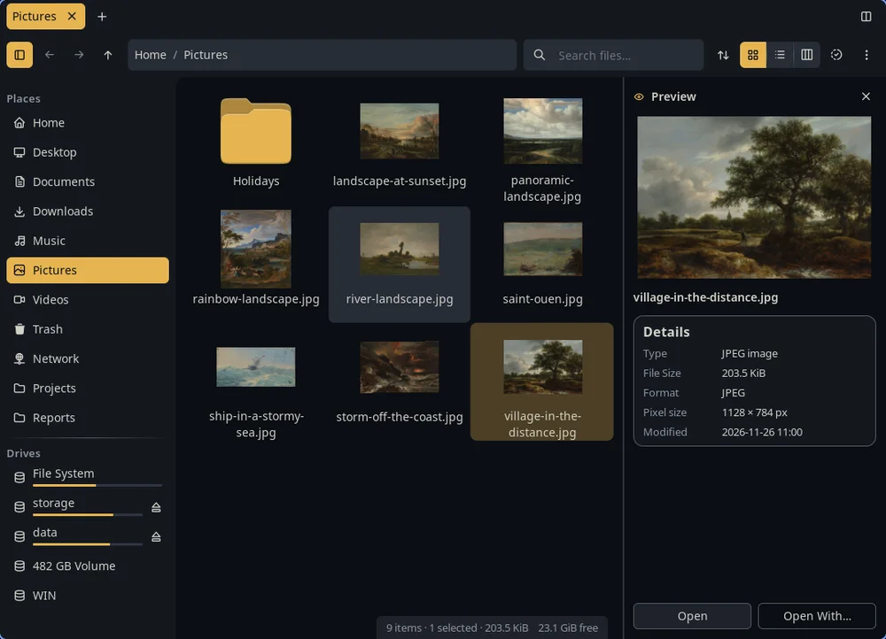

# Luciole

Luciole is a native Wayland file manager with grid, list and column views, tabs, split view and a side preview. It runs independently of the Noctalia shell. The application is in development; these guides describe current features.

## Guides

| Page | Purpose |
|---|---|
| **Getting started** | |
| [Installation](installation.md) | Install from a package, Nix or Guix |
| [Building from source](building.md) | Dependencies and build commands |
| [Getting started](getting-started.md) | Start Luciole, tour the window, learn shortcuts |
| [File picker](file-picker.md) | Use Luciole for other applications' Open and Save dialogs |
| **Basics** | |
| [Navigation](navigation.md) | Location bar, search, history and keyboard navigation |
| [Views](views.md) | Grid, list and column views, sorting and selection |
| [Tabs and split view](tabs-and-windows.md) | Tabs, two panes and windows |
| [Sidebar and drives](sidebar.md) | Places, pinned folders, drives and unlocking |
| [Preview and Properties](preview-and-properties.md) | Preview files, inspect details and permissions |
| **Files** | |
| [File operations](file-operations.md) | Copy, move, rename, drag and drop, conflicts |
| [Undo and redo](undo-redo.md) | Reverse the last file operation |
| [Trash](trash.md) | Delete, restore and empty the Trash |
| [File operations](file-operations.md) | Copy, move, create, rename and background operations |
| [Undo and redo](undo-redo.md) | What you can take back |
| [Trash](trash.md) | Delete, restore and empty |
| [Archives](archives.md) | Browse, extract and create archives |
| [Opening files](opening-files.md) | Default apps, Open With, running programs, terminals |
| [Custom scripts](scripts.md) | Add your own actions |
| **Network** | |
| [Network folders](network.md) | SFTP, SMB and WebDAV locations |
| **Customize** | |
| [Settings](settings.md) | Tour the Settings page |
| [Configuration reference](configuration.md) | Every `config.toml` key |
| [Keyboard shortcuts](keybinds.md) | Default shortcuts and customization |
| **Help** | |
| [Troubleshooting](troubleshooting.md) | Symptoms, causes and fixes |

## Get help

Report problems on the [issue tracker](https://github.com/noctalia-dev/luciole/issues) or ask on [Discord](https://discord.noctalia.dev). Include the Luciole version, your distribution and a small reproduction. For development, see [Contributing](../../CONTRIBUTING.md), the [design notes](../design/README.md) and [Packaging](../../PACKAGING.md).
